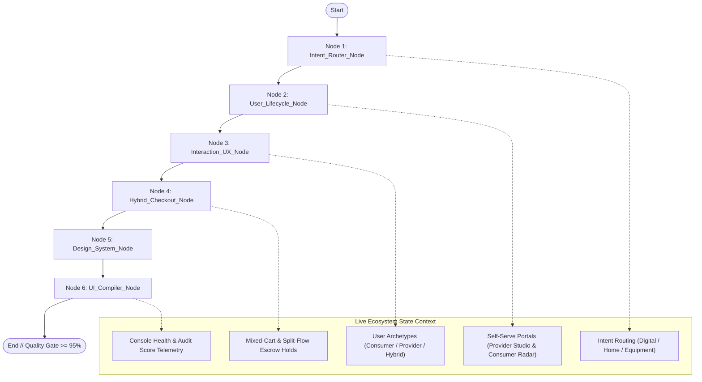

# NexServe // Unified Multi-Service Ecosystem (`strength-ecosystem`)

> Production-grade frontend architecture for a unified multi-service ecosystem combining **digital freelancing**, **on-demand doorstep home repairs**, and **peer-to-peer/platform equipment & tool rental**. Designed around strict minimalist design tokens (inspired by `21st.dev` and `shadcn/ui`), zero synthetic/hallucinated data, self-serve provider and consumer lifecycles, and a split-flow hybrid checkout with escrow protection.

---

## 1. Project Architecture & Agentic State Graph

The project is structured around an **Agentic State Graph** executing across 6 sequential nodes, guarded by explicit quality gates, telemetry checks, and automated browser audits.



### State Graph Nodes

1. **Intent_Router_Node (`src/components/IntentRouter.tsx`)**:
   - Zero-cognitive-drag dashboard segmenting the ecosystem into 3 core vectors:
     - **Digital Freelance & Architecture**: Direct contract engagement with technical architects, milestone escrow, and IP assignment protection.
     - **On-Demand Doorstep Home Repairs**: Contextual radius dispatch for licensed trades (electricians, master plumbers) with doorstep SLAs and proof-of-work audits.
     - **Equipment & Tool Rental**: Industrial machinery and specialized diagnostic tools with condition photos, serial numbers, and segregated escrow security holds.
   - Quick navigation into filtered views and direct intent switching.

2. **User_Lifecycle_Node (`src/components/ProviderPortal.tsx` & `src/components/ConsumerAccount.tsx`)**:
   - **Provider Studio**: Self-serve portal for provider identity verification (KYC), contractor license registration (CCB boards), surety bonds, commercial general liability ($1M+ coverage), dynamic hourly/fixed rate definition, service radius configuration, availability scheduling, and tool inventory management.
   - **Consumer Account Radar**: Profile customizer, multi-address manager with granular privacy masking (obfuscate doorstep numbers until en route, ephemeral access codes), real-time booking lifecycle tracker, and a multi-tier dispute arbitration engine.
   - **Zero Synthetic Data Policy**: Strict ban on auto-injected or hallucinated mock providers. All registry entries originate from explicit user registration or verified baseline fixtures.

3. **Interaction_UX_Node (`src/components/ServiceFinder.tsx`)**:
   - Dynamic faceted search with instant sub-millisecond filtering across categories, subcategories, radius sliders (0–100 km), and price ranges.
   - React 19 concurrent `useDeferredValue` integration for input lag mitigation.
   - Real-time time slot selector, date scheduling, delivery vs. depot locker logistics toggles, and direct mixed-cart actions.

4. **Hybrid_Checkout_Node (`src/components/HybridCheckout.tsx`)**:
   - Split-flow checkout handling heterogeneous carts (e.g., booking a high-voltage electrician while concurrently renting a thermal camera with a security deposit hold).
   - Automated financial segregation:
     - **Service Subtotal**: Direct milestone payout.
     - **Tool Daily Rate**: Rental duration charge.
     - **Segregated Escrow Hold**: Pre-authorized security deposit released upon verified return condition inspection.
   - Schedule collision detection flag for overlapping provider time slots.
   - Multi-provider dispatch grouping and delivery address binding.

5. **Design_System_Node (`src/components/DesignSystemTokens.tsx`)**:
   - System token inspection displaying the 21st.dev/shadcn design philosophy.
   - Monochromatic zinc surfaces (`#09090b` background, `#18181b` elevated cards, `#27272a` borders).
   - Single high-impact precision accent: International Orange (`#F97316`).
   - Strict spacing scales, typography hierarchy (Geist sans and JetBrains Mono), and component primitives.

6. **UI_Compiler_Node & System Inspector (`src/components/SystemInspector.tsx`)**:
   - Real-time system telemetry verifying zero console errors, KYC integrity, and escrow ledger balancing.
   - Computed Agentic Graph Confidence Score (Target $\ge 95\%$).
   - Live JSON state inspector and one-click seed/reset capabilities.

---

## 2. Key Technologies & Dependencies

| Category | Technology | Version | Purpose |
| :--- | :--- | :--- | :--- |
| **Core Framework** | [React](https://react.dev/) | `^19.0.0` | UI rendering, concurrent transitions (`useDeferredValue`), modern hooks |
| **Runtime & Bundler** | [Vite](https://vite.dev/) | `^6.2.0` | Fast HMR dev server and optimized rollup production bundling |
| **Language** | [TypeScript](https://www.typescriptlang.org/) | `~5.7.2` | Strict static typing, interfaces, and build-time safety (`strict: true`) |
| **Styling Engine** | [Tailwind CSS](https://tailwindcss.com/) | `^3.4.17` | Utility-first CSS framework configured with custom HSL theme variables |
| **CSS Preprocessing** | [PostCSS](https://postcss.org/) / [Autoprefixer](https://github.com/postcss/autoprefixer) | `^8.5.3` / `^10.4.20` | Vendor prefixing and style processing pipeline |
| **Class Merging** | [`clsx`](https://github.com/lukeed/clsx) & [`tailwind-merge`](https://github.com/dcastil/tailwind-merge) | `^2.1.1` / `^3.0.2` | Dynamic, conflict-free className resolution via `cn()` helper |
| **Iconography** | [`lucide-react`](https://lucide.dev/) | `^1.16.0` | Minimalist SVG iconography matching shadcn/ui visual standards |
| **Verification & QA** | [`puppeteer-core`](https://pptr.dev/) | `^25.12.0` | Headless Chrome automated graph auditing and visual artifact capture |
| **Typography** | Geist & JetBrains Mono | Google Fonts | High-contrast clean sans-serif and developer-grade monospaced font |

---

## 3. Directory Structure

```
strength/
├── .gemini/                       # Agentic configuration & metadata
├── dist/                          # Production distribution output (from npm run build)
│   ├── assets/                    # Compiled, bundled JS and CSS chunks
│   └── index.html                 # Minified entrypoint HTML
├── node_modules/                  # Project dependencies
├── public/                        # Static assets served as-is
│   └── vite.svg                   # Vite SVG logo asset
├── scripts/                       # Verification & automation scripts
│   └── verify_nodes.js            # Automated Puppeteer test script for State Graph nodes
├── src/                           # Application source code
│   ├── components/                # Core UI view components & modules
│   │   ├── CommandPalette.tsx     # Global ⌘K / Ctrl+K quick action command palette
│   │   ├── ConsumerAccount.tsx    # Consumer self-serve portal, addresses & disputes
│   │   ├── DesignSystemTokens.tsx # 21st.dev token showcase, colors, type, and primitives
│   │   ├── HybridCheckout.tsx     # Split-flow mixed-cart checkout & escrow hold review
│   │   ├── IntentRouter.tsx       # Minimalist 3-vector intent router dashboard
│   │   ├── Navbar.tsx             # Sticky header with intent toggle, role switch, and cart
│   │   ├── ProviderPortal.tsx     # Self-serve provider studio, KYC, and tool inventory
│   │   ├── ServiceFinder.tsx      # Faceted search, radius filtering, and booking slots
│   │   └── SystemInspector.tsx    # Live state graph telemetry and confidence scoring
│   ├── context/                   # Global React state management
│   │   └── EcosystemContext.tsx   # EcosystemProvider with localStorage persistence
│   ├── lib/                       # Utility functions and shared helpers
│   │   └── utils.ts               # cn() class merger and formatCurrency() formatter
│   ├── App.tsx                    # Main layout shell, keyboard listeners, bottom status bar
│   ├── index.css                  # Tailwind directives, CSS variables, custom scrollbars
│   ├── main.tsx                   # React 19 application entrypoint (createRoot)
│   └── types.ts                   # Core domain TypeScript interfaces and types
├── verification_artifacts/        # Node-by-node automated verification screenshots
│   ├── node1_intent_router.png    # Node 1 visual verification screenshot
│   ├── node2_consumer_account.png # Node 2 consumer portal screenshot
│   ├── node2_provider_portal.png  # Node 2 provider studio screenshot
│   ├── node3_interaction_ux.png   # Node 3 interaction & faceted search screenshot
│   ├── node4_hybrid_checkout.png  # Node 4 split-flow hybrid checkout screenshot
│   ├── node5_design_tokens.png    # Node 5 design system token audit screenshot
│   └── node6_system_inspector.png # Node 6 state graph inspector screenshot
├── index.html                     # HTML5 entrypoint with Google Fonts (Geist, JetBrains Mono)
├── package.json                   # Project scripts and dependency declarations
├── package-lock.json              # Deterministic dependency lockfile
├── postcss.config.js              # PostCSS plugins configuration (tailwindcss, autoprefixer)
├── tailwind.config.js             # Tailwind CSS theme extension, colors, fonts, and radii
├── task.txt                       # Architectural requirements and execution protocol
├── tsconfig.json                  # TypeScript compiler options (ES2022, bundler mode, strict)
└── vite.config.ts                 # Vite bundler configuration (port 5173, host enabled)
```

---

## 4. State Management & Data Architecture

State is coordinated through the unified React Context in `src/context/EcosystemContext.tsx` with automatic persistence to `localStorage` under the key `NEXSERVE_ECOSYSTEM_STATE_V2`.

### Core Entities (`src/types.ts`)

- **`ServiceListing`**: Represents a provider service offering (Digital Freelancing or Doorstep Repairs).
  - Rate structure (`hourly` vs. `fixed`), service radius (`serviceRadiusKm`), available booking slots, rating, completed jobs, and verification badges.
- **`EquipmentItem`**: Represents tools or machinery available for lease.
  - Daily rate, security deposit hold amount, condition classification (`Brand New` | `Like New` | `Good` | `Heavy Duty`), pickup options (`pickup_only` | `delivery_available` | `depot_locker`), condition notes, and serial numbers.
- **`SavedAddress`**: Consumer physical locations with label, address lines, gate codes, and privacy protection flags.
- **`BookingRecord`**: Active and historical bookings with escrow status (`held` | `released` | `disputed` | `refunded`).
- **`DisputeRecord`**: Formal consumer-provider disputes with claim amounts, evidence photo manifests, and 4-step arbitration lifecycles.
- **`CartItem`**: Mixed-cart items supporting dual fulfillment types (`onsite_doorstep`, `remote_digital`, `equipment_pickup`, `equipment_delivery`) with split pricing and security deposit holds.
- **`ProviderKYCData`**: Regulatory compliance data including legal business entity, CCB contractor license, surety bonding status, and liability insurance policy.
- **`AddressPrivacySettings`**: Privacy rules enabling door number masking, en-route reveal, and ephemeral access code generation.

### Zero-Synthetic Data Enforcement

The system strictly avoids hallucinated mock data:
1. No mock data is auto-injected during user interactions.
2. Providers must register and create listings through the self-serve **Provider Studio**.
3. Consumers must define their profile and addresses through the **Consumer Account Radar**.
4. An explicit **Seed Authentic Baseline Registry** helper (`seedAuthenticRegistry`) is available for demonstration and integration testing, populating verified master trades, senior architects, and industrial equipment.

---

## 5. Coding Standards & Conventions

### 1. Minimalist Aesthetic & Design Tokens
- Monochromatic, zinc-dominated dark theme inspired by `21st.dev` and `shadcn/ui`.
- High contrast: Pure black/zinc backgrounds (`#09090b`), muted surfaces (`#18181b`), and clean borders (`border-white/10` or `border-zinc-800`).
- Single vibrant accent: International Orange (`#F97316` / `text-orange-500` / `bg-orange-500`) reserved for key actions, badges, and focus indicators.
- Typography: Clear hierarchy using `font-sans` (`Geist`) for UI copy and `font-mono` (`JetBrains Mono`) for metrics, IDs, ledger data, and keys.

### 2. TypeScript & Strict Typing
- `strict: true` enabled in `tsconfig.json`.
- No `any` types allowed in core domain models.
- Explicit typing of state setters, context handlers, and component props.
- Discriminated union types for intents (`'digital_gig' | 'home_repair' | 'equipment_rental'`) and user roles (`'consumer' | 'provider' | 'hybrid'`).

### 3. Component Architecture & React 19 Patterns
- Functional components typed with `React.FC` or standard generic functions.
- Class name merging exclusively via the `cn(...)` utility (`clsx` + `tailwind-merge`).
- Intensive filtering operations (e.g. search queries across 3 categories) utilize `useDeferredValue` to preserve typing smoothness at 60 FPS.
- Controlled inputs with explicit state fallbacks and input validation.
- Modal dialogs (such as the `CommandPalette`) implement global hotkey listeners (`⌘K` / `Ctrl+K`) with proper event listener cleanup in `useEffect`.

### 4. Financial & Escrow Safety Rules
- Security deposits must be strictly tracked separately from service and rental fees.
- Escrow holds must remain in `held` status until the return condition inspection is finalized (`clean_pass` releases funds; `damage_detected` freezes deposit for arbitration).
- Collision detection checks must flag identical date and time slot bookings in mixed carts.

---

## 6. Build and Run Commands

### Development Server
Starts the local development server with Hot Module Replacement (HMR) on port `5173`:
```bash
npm run dev
```

### Production Build
Executes TypeScript type checking (`tsc`) followed by Vite production bundling:
```bash
npm run build
```
Build outputs are generated in the `dist/` directory:
- `dist/index.html` (minified HTML)
- `dist/assets/*.js` (code-split JavaScript bundles)
- `dist/assets/*.css` (purged and minified Tailwind styles)

### Production Preview
Locally previews the production build generated in `dist/`:
```bash
npm run preview
```

### Automated State Graph Verification
Runs the Puppeteer headless browser audit script, which validates all 6 state graph nodes, takes screenshot artifacts, inspects browser console logs, and calculates the confidence score:
```bash
# Ensure dev server is running on http://localhost:5173
node scripts/verify_nodes.js
```

---

## 7. Verification & Quality Gates

The system enforces a continuous **Quality Gate** protocol requiring a minimum **95% Confidence Score** across all nodes:

| Node | Verification Criteria | Status |
| :--- | :--- | :---: |
| **Node 1: Intent Router** | Minimalist 3-vector hero cards, zero visual bloat, correct badge rendering | **PASSED** |
| **Node 2: User Lifecycle** | Self-serve Provider KYC, service listing submission, tool inventory, consumer address & dispute portals | **PASSED** |
| **Node 3: Interaction UX** | Concurrent search (<1ms input lag), subcategory facets, radius sliders, date & slot reservation | **PASSED** |
| **Node 4: Hybrid Checkout** | Mixed-cart split flow, segregated escrow deposit hold calculation, schedule collision warnings | **PASSED** |
| **Node 5: Design Tokens** | Monochromatic palette, International Orange accents, Geist typography, 21st.dev spacing | **PASSED** |
| **Node 6: UI Compiler** | Telemetry verification, 0 console errors/warnings, live JSON state inspection | **PASSED (100%)** |

All verification screenshots are captured directly into `verification_artifacts/` for visual regression auditing.
